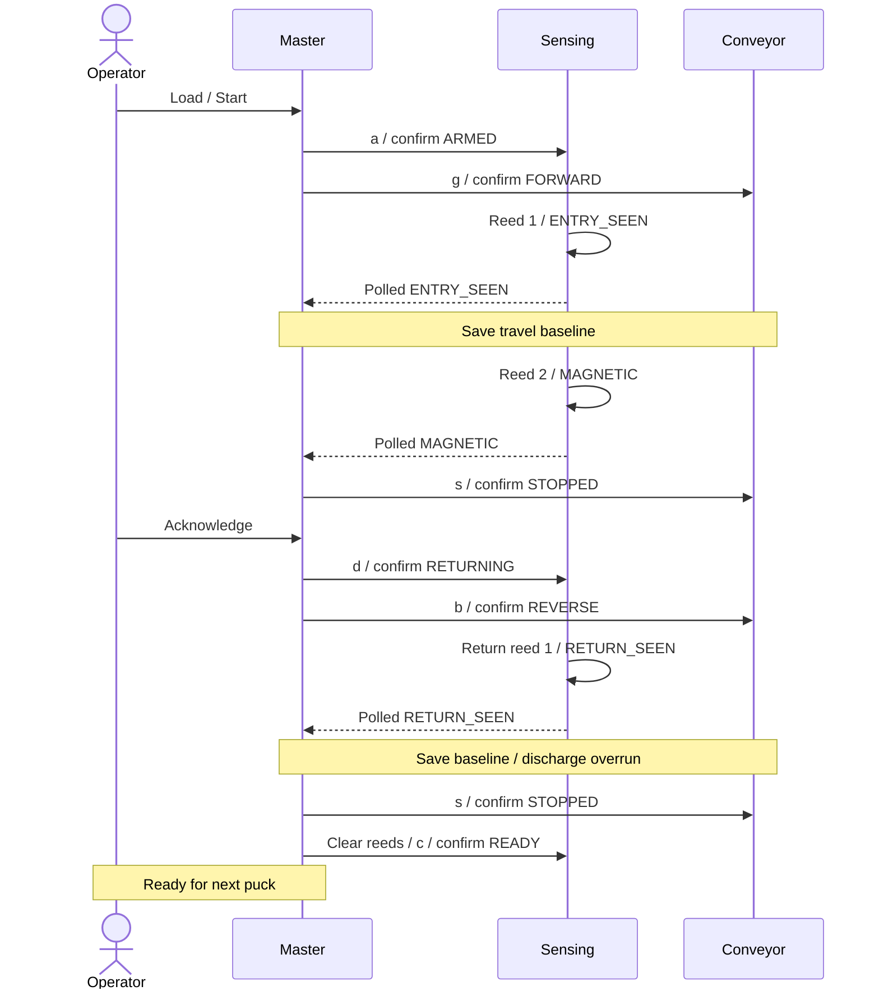

# Shared contract — v1 design, not implemented

This file defines the external interface. Subsystem READMEs explain local work; they do not override these rules. The operating sequence is agreed. Byte assignments and timing defaults are implementation specifications, not verified firmware behaviour. Use Arduino Wire without another messaging library, CRC, sessions or command IDs.

## Agreed operation

Load one puck before reed 1. Run forward. Reed 1 records arrival; reed 2 completes magnetic detection. Stop and wait for operator acknowledgement. Then reverse past reed 1, run a calibrated discharge overrun and stop. Prepare the next cycle only after both reeds are clear.

No reed activity before arrival is normal. There is no no-detection deadline or non-magnetic classification. Operator Stop pauses the current phase. Resume preserves the phase and travel progress. Missing an expected reed causes a latched FAULT. Remove all pucks and restart all three boards to clear it. Never resume a faulted cycle.

## Wire format

The master initiates every transaction. Write exactly one ASCII command byte, without newline or NUL. Read status separately. Addresses are 7-bit. Unknown commands, wrong-length writes and failed guards have no effect. An ACK confirms delivery, not action completion. Confirm actions by polling.

| Board | Address | Reply length | State byte values |
| --- | --- | --- | --- |
| Conveyor | `0x10` | 10 bytes | 0 STOPPED, 1 FORWARD, 2 REVERSE, 3 FAULT |
| Sensing | `0x11` | 8 bytes | 0 READY, 1 ARMED, 2 ENTRY_SEEN, 3 MAGNETIC, 4 RETURNING, 5 RETURN_SEEN, 6 FAULT |

| Offset | Field | Definition |
| --- | --- | --- |
| 0, both | state: uint8 | Board-specific value above. |
| 1, both | fault: uint8 | 0 NONE, 1 CONTACT_LOST, 2 REED_ORDER, 3 LOCAL, 4 MASTER_REQUEST. |
| 2–5, both | uptime_ms: uint32 | Main-loop snapshot of milliseconds since boot. |
| 6–9, conveyor | issued_steps: uint32 | Total emitted library steps in either direction since boot. |
| 6, sensing | live_mask: uint8 | Debounced input bits: bit 0 reed 1, bit 1 reed 2. |
| 7, sensing | seen_mask: uint8 | Retained event bits: bit 0 forward reed 1, bit 1 forward reed 2, bit 2 return reed 1. |

Use little-endian order for uint32 fields. Other mask bits must be zero. Send numeric bytes, not ASCII digits. Serialize explicitly; do not transmit a C++ struct. Publish coherent snapshots. FAULT requires a nonzero fault; healthy states require zero. REED_ORDER is sensing-only. Preserve the first fault reason. The master retains detailed system reasons such as MISSING_FORWARD or MISSING_RETURN when it sends MASTER_REQUEST. UNKNOWN is a master display condition, never a wire state.

Conveyor step count increases in both directions. Count emitted steps, not a requested move length. Do not reset on stop or direction changes. Use unsigned subtraction from saved baselines and keep each travel limit below half the counter range. Natural counter rollover is valid. Estimated millimetres = step delta / calibrated steps per millimetre. This is not physical position feedback. Slips, stalls and actual ejection are not verified.

## Commands and guards

| Board | Command | Legal behaviour |
| --- | --- | --- |
| Conveyor | `g` | STOPPED → FORWARD. Already FORWARD: no-op. REVERSE or FAULT: ignore. |
| Conveyor | `b` | STOPPED → REVERSE. Already REVERSE: no-op. FORWARD or FAULT: ignore. |
| Conveyor | `s` | Stop issuing steps. Healthy → STOPPED after applying stop. FAULT stays FAULT. Discard older queued movement. |
| Sensing | `a` | READY with initialised, clear reeds → ARMED. Already ARMED: no-op. Otherwise ignore. |
| Sensing | `d` | MAGNETIC → RETURNING. Retain forward events. Already RETURNING or RETURN_SEEN: no-op. Master sends only after confirmed motor stop and operator acknowledgement. |
| Sensing | `c` | RETURN_SEEN with clear reeds → READY; clear retained events. READY with clear reeds: no-op. Master sends only after confirmed discharge stop. |
| Either | `!` | Enter FAULT / MASTER_REQUEST unless already faulted. Conveyor stops. Preserve retained sensor events. |

No command clears FAULT. No speed command exists in v1 I2C. Fix speed in conveyor configuration. A direction change requires confirmed STOPPED first. Standalone Serial controls must not compete with master commands.

## Sensing transitions

| Current state | Event | Next state and retained bits |
| --- | --- | --- |
| READY | Eligible `a` | ARMED, seen_mask = 0 |
| ARMED | New reed 1 activation | ENTRY_SEEN, seen_mask = 1 |
| ARMED | Reed 2 first, or both activate in the same sample | FAULT / REED_ORDER |
| ENTRY_SEEN | New reed 2 activation | MAGNETIC, seen_mask = 3 |
| MAGNETIC | Eligible `d` | RETURNING, seen_mask = 3 |
| RETURNING | New reed 1 activation | RETURN_SEEN, seen_mask = 7 |
| RETURN_SEEN | Eligible `c` | READY, seen_mask = 0 |
| Any healthy state | Fault or `!` | FAULT; retain prior event bits |

Reed openings do not erase events. Repeated entry activations do not restart tracking. Return-mode reed 2 activity is expected and cannot classify another puck. Do not require another reed 2 edge on return; it may already be active at the stopping point. The master requires reed 1 clear before authorising discharge. Sample and report live inputs in every state. READY reports inputs without classifying them. MAGNETIC and RETURN_SEEN retain their events despite later input changes.

Andon mapping: READY off; ARMED, ENTRY_SEEN, RETURNING and RETURN_SEEN green; MAGNETIC amber; FAULT red. The master sends `!` for missing-arrival faults and shows the detailed reason over Serial. A broken bus can delay remote red indication until the local watchdog expires. LEDs indicate sensing state, not verified mechanical safety.

## Global rules

1. Boot conveyor STOPPED and sensing READY. Request stop during startup. Require fresh healthy status and clear reeds before Start. Unexpected retained state requires a full reset, not automatic clearing.
2. The master owns process phase and targets. Slaves own stepping, debounce and status. Poll sensing then conveyor every 100 ms in every master state.
3. Send actions once on transition. Allow 300 ms for confirmation. Retry only `s` and `!`, at most once per poll cycle. Never extend the original deadline.
4. Mark feedback UNKNOWN after 300 ms without a valid reply. Invalid length, values, event bits or unexpected state causes FAULT. Allow the previous healthy state within a command's confirmation deadline.
5. Refresh snapshots from the main loop at least every 20 ms. Fault if returned uptime does not advance for 300 ms. Use unsigned deltas for normal rollover. An observed reboot or discontinuity invalidates the cycle. Uptime is diagnostic feedback, not complete hang detection.
6. After first master contact, no status request for 1,000 ms causes a local FAULT, including while paused or stopped. Reads renew contact but never resume or reset. Bound master Wire calls so a stuck bus cannot block fault handling indefinitely.
7. On system fault, request motor stop and send `!` to both boards. Latch master FAULT. Missing motion feedback means STOP UNCONFIRMED. No software state proves mechanical rest.
8. Stop saves the active phase, cancels pending motion and sends `s`. Enter PAUSED only after confirmed stop. Resume reconciles retained events before requesting motion. Never re-arm or clear history on Resume.
9. Retain travel baselines through pauses. Paused time cannot cause missing arrival; communication checks remain active. Events received during stopping or pause still count. Faults take priority over operator commands.
10. After forward reed 1, apply a calibrated step allowance to reach reed 2. During reverse, apply a calibrated allowance to reach reed 1. Exceeding an allowance without the expected event causes FAULT. A valid expected event wins over the travel limit in the same poll cycle.
11. At return reed 1, save the discharge-overrun baseline. Run the additional steps, stop, confirm STOPPED and require clear reeds. Send `c`, confirm READY, then permit the next load. A held reed at completion causes FAULT.
12. Full reset means stop/isolate the drive as needed, remove all pucks, restart all three boards and pass startup checks. V1 has no software reset command. Restarting only one board is not recovery.

Timing values are bench defaults, not safety guarantees. Software stop is not an emergency-stop system. Step allowances are based on emitted motion; they cannot diagnose a motor that receives steps but does not move.

## Normal sequence

## Calibration and integration inputs

Measure fixed speed, step unit, steps/mm, reed spacing, forward/return allowances, discharge overrun, debounce, sample interval and stopping/polling margin. Master-observed events are delayed by polling; account for this in calibration. The master can receive MAGNETIC without observing ENTRY_SEEN first; accept it with both retained forward bits set. Never reset a baseline on repeated replies.

Import the working motor sketch to confirm library, driver, pins, supply, reverse support and idle-coil behaviour. Confirm reed/LED wiring and polarity. Use common ground, Uno SDA/A4 and SCL/A5, suitable pull-ups and a compatible motor driver/supply. Never drive coils from GPIO. Screen, buzzer, Teleplot formatting and speed control are stretch work. Actual ejection remains unverified without an additional sensor.
