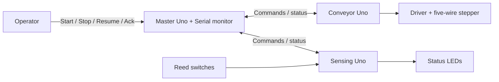

# ICTE4005 magnetic-puck conveyor

Three Arduino Unos coordinate a magnetic-puck detection and return demonstration. Load one puck before the reeds. Reed 1 records arrival; reed 2 causes a magnetic-detection stop. After operator acknowledgement, reverse past reed 1 and run a calibrated discharge overrun. Then stop and prepare the next cycle. This demonstrates distributed control, not material identification or verified automatic sorting.

No reed activity means continue until the operator stops. Stop pauses the phase; Resume retains progress. Missing an expected reed causes a latched fault. Remove all pucks and restart all three boards before a new cycle. Reed 1 sits near the loading/discharge edge. Step counting estimates discharge travel; it does not verify ejection.

## Boards and documents

- [Master](master/README.md): process coordination, polling, travel checks and Serial target/current reporting.
- [Conveyor](conveyor/README.md): fixed-speed forward/reverse stepper motion and issued-step feedback.
- [Sensing](sensing/README.md): two reeds, forward/return event retention and andon LEDs.
- [Shared contract](CONTRACT.md): exact messages, state values, guards, fault rules and calibration inputs.



## Current implementation

All three projects contain scaffolds only. They print their role at 9600 baud; no motor, sensing, screen or I2C behaviour is implemented. Import and preserve the working sketches before integration. Do not upload these scaffolds over working demonstration firmware.

The docs describe a proposed interface, not tested behaviour. They replace the earlier complex Barbot contract as this repository's planning reference. Protocol details belong in `CONTRACT.md`; wiring, libraries and local operation belong in each subsystem README.

## PlatformIO

Open [icte4005.code-workspace](icte4005.code-workspace) or an individual board folder in VS Code. Each folder has its own `platformio.ini` and `src/main.cpp`, targeting classic Uno/R3 (`uno`, Arduino framework, AVR platform 5.0.0).

```sh
pio run -d master
pio run -d conveyor
pio run -d sensing
pio device list
pio run -d conveyor -t upload --upload-port /dev/cu.YOUR_BOARD
pio device monitor -d conveyor --port /dev/cu.YOUR_BOARD --baud 9600
```

Replace the project and port as needed. No upload port is hard-coded. When importing an `.ino` into `main.cpp`, add `Arduino.h` and required forward declarations; keep one `setup()` and `loop()` per project. Add actual external libraries to that project's `lib_deps` and preserve proven pins and baud rate.

Validation on 11 October 2026: all three scaffold projects compile successfully with the standard PlatformIO AVR toolchain. The earlier compiler launch issue is resolved. No hardware upload, I2C integration or mechanical operation is verified.

## Scope and remaining work

V1 uses fixed speed, two reeds, status LEDs and a Serial operator interface. Screen, buzzer, Teleplot formatting and adjustable speed are stretch work. No non-magnetic classification or automatic no-detection timeout is included. Uptime supports feedback diagnostics; issued steps support estimated travel.

The operating sequence is agreed. Remaining inputs are the working motor sketch, hardware/library details and measured calibration values. Each subsystem README defines its owner's deliverables and verification evidence. Protocol rules belong in the shared contract; local implementation details belong in subsystem READMEs; project scope belongs here.
