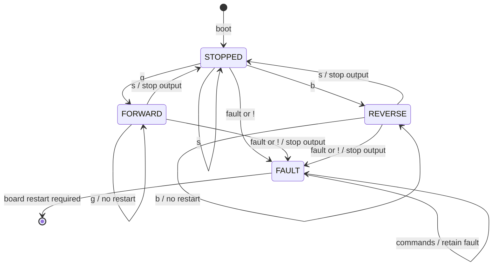

# Conveyor Arduino — motion

[Shared contract](../CONTRACT.md) · [Build instructions](../README.md#platformio)

Scaffold only. Import the working motor sketch and preserve its library and wiring. Confirm reverse operation before integration. Do not upload this scaffold over working demonstration firmware.

## Work package and deliverables

Deliver fixed-speed forward/reverse motion, responsive stop, cumulative issued-step counting, Wire commands/status and a latched contact watchdog. Provide library/version, driver, pins, supply, step unit, fixed speed and idle-coil behaviour. Measure steps/mm and stop response with the assembled belt.

The master decides when movement starts and ends. This board does not sample reeds or complete finite moves automatically. Count each emitted library step once, positively in either direction. Do not reset the count on go, stop or reversal. Status describes software drive output, not measured belt movement.

## States keyed to commands

Reject direct reversal. Require stop confirmation before the opposite direction command. There is no I2C speed or reset command. Existing Serial `g/s/f/l` may remain in an explicit standalone bench mode. Bench commands must not compete with master commands; bus loss must not select bench mode.

## Implementation and verification

Keep stepping non-blocking. Wire receive callbacks queue commands; request callbacks return prepared status. Stop/fault requests take priority over older pending motion. Protect multi-byte snapshots from interrupt access. Apply the shared watchdog while moving and stopped after first contact.

Demonstrate both directions, responsive stop, repeated-command behaviour, rejected direct reversal, continuous step count, contact timeout and reset-only recovery. Measure stop latency under load. No encoder or stall detection is assumed. Adjustable speed is separate stretch work.
