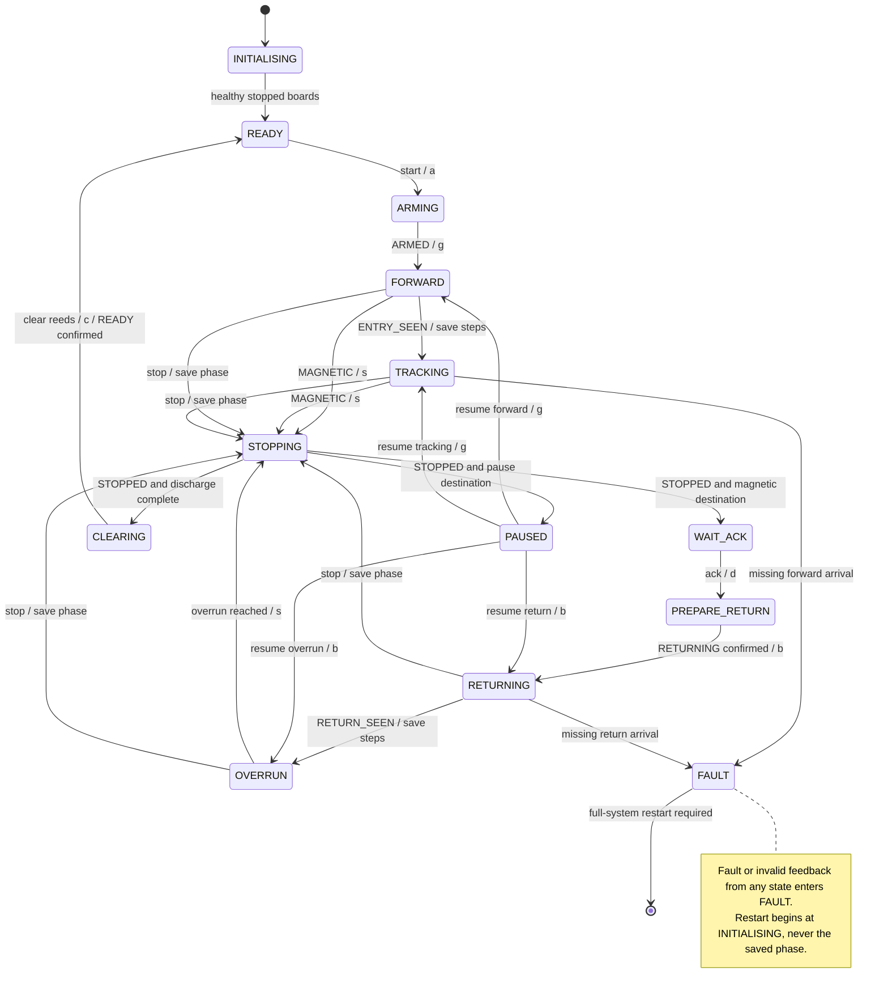

# Master Arduino — process coordination

[Shared contract](../CONTRACT.md) · [Build instructions](../README.md#platformio)

Scaffold only. Implement Serial controls first. Screen, Teleplot formatting and buzzer are stretch work. The master does not step the motor or debounce reeds.

## Work package and deliverables

Deliver the Wire client, process state machine, Serial controls, target/current reporting, travel checks and integration evidence. Show slave state, fault and feedback age. Show travel as estimated, not measured. Keep detailed reasons such as MISSING_FORWARD and MISSING_RETURN locally.

Use Serial commands `start`, `stop`, `resume` and `ack`, terminated by newline. These operator commands are not I2C payloads. Accept Start only in READY, Resume only in PAUSED, and Ack only in WAIT_ACK after confirmed stop. There is no fault-clear command.

## States and actions

| State | Responsibility |
| --- | --- |
| INITIALISING | Request stop; require fresh STOPPED, sensor READY and clear reeds. |
| READY | Wait for manual loading and Start. |
| ARMING | Send `a`; confirm ARMED before requesting motion. |
| FORWARD | Send `g` once. No arrival has no deadline. |
| TRACKING | Save first entry step baseline; check travel to reed 2. |
| STOPPING | Send `s`; confirm STOPPED before entering the saved destination. |
| WAIT_ACK | Show magnetic detection; wait for operator acknowledgement. |
| PREPARE_RETURN | Require reed 1 clear; send `d`; confirm RETURNING before reverse. |
| RETURNING | Send `b` once; check travel to return reed 1. |
| OVERRUN | Continue reverse for calibrated steps from return detection. |
| CLEARING | Require stop and clear reeds; send `c`; confirm READY. |
| PAUSED | Keep polling; retain phase and travel baselines. |
| FAULT | Stop, request slave faults and retain reason until full-system restart. |

The diagram shows principal paths. Stop during ARMING or PREPARE_RETURN also saves the pending phase and cancels motion. Reconcile any in-flight sensor command before Resume; never allow a delayed motor start. Stop in READY, WAIT_ACK or PAUSED keeps the motor stopped. Stop during final clearing needs no extra motion.

Before Resume, process retained events: MAGNETIC goes to WAIT_ACK without forward motion; RETURN_SEEN advances to OVERRUN; a completed overrun proceeds to CLEARING. Preserve the first event baseline and count steps issued during deceleration. Events before any movement was authorised cause a fault rather than automatic movement. A valid terminal event may skip an intermediate polled state.

## Verification deliverables

Record the complete magnetic cycle, indefinite operation without detection, pauses in each moving phase, events during stopping, missing forward/return arrival, held reeds, lost feedback and partial board reset. Verify that faults prevent Resume and UNKNOWN never means confirmed stop. Record calibrated allowances and actual stopping distance. Scaffold compilation does not verify hardware behaviour.
