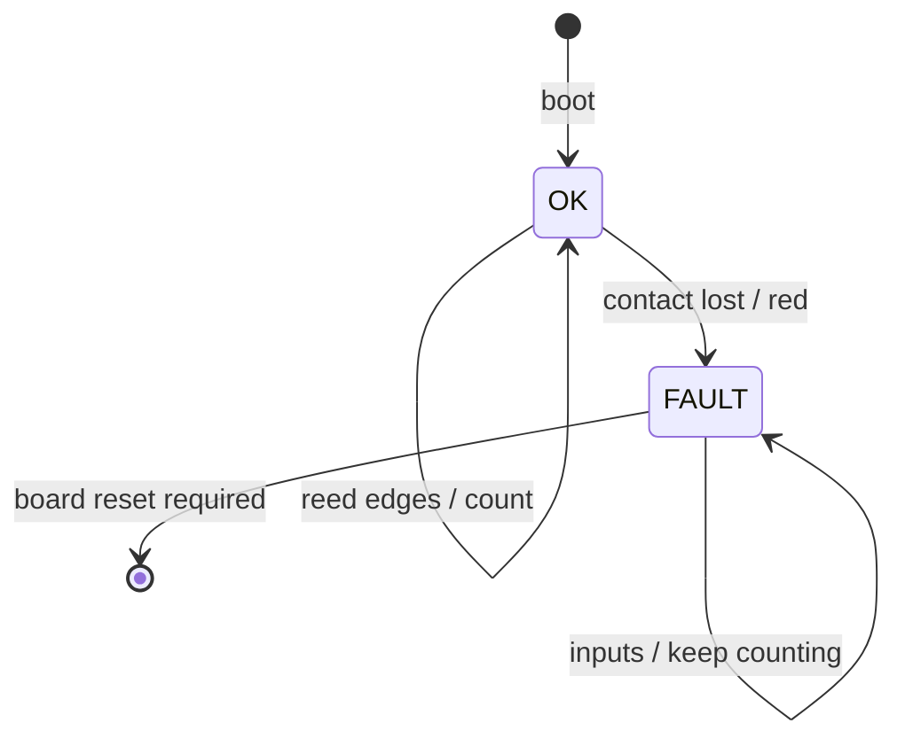

# Sensing Arduino — two reeds and local LEDs

[Shared contract](../CONTRACT.md) · [Build instructions](../README.md#platformio)

Seed code is in place. Set the pins in `src/main.cpp` to the assembled wiring. Place reed 1 near the loading/discharge end and reed 2 at the forward magnetic stopping point. Confirm polarity, exposure and debounce on the assembled conveyor.

## What this board owns

Debounce, a cumulative closing-edge count per reed, its LEDs from the live reed levels, and its own contact watchdog. It accepts no commands. It reports OK or FAULT, a fault reason, uptime, the live mask and the two edge counts. It holds no process state. The master decides what an edge means from the direction the belt is running.

## Code layout

- `lib/sensing_logic`: debounce, counters, LED decision and the reply encoder. Pure C++, so the master's host tests run it directly.
- `src/main.cpp`: pins, sample interval, the Wire link and the publish loop.
- `../shared/slave_link.h`: Wire slave boilerplate shared with the conveyor board.

The owner sets pins, sample interval and debounce time. Counters only increase and wrap; never clear them. Sample inputs independently of master polling and keep sampling in every state.

## LEDs

Green while reed 1 reads closed. Amber while reed 2 reads closed. Red while the board is in FAULT. Off otherwise. The LEDs show the local reading only. Process phase is shown on the master andon.

## States

## Verification

Record short exposure at the fixed speed, held and repeated contacts, both reeds closed, reverse passage, contact timeout and retained fault. Measure the debounce needed on the assembled belt. A disconnected normally-open reed looks open. Non-magnetic pucks produce no edges and no claim about the puck.
