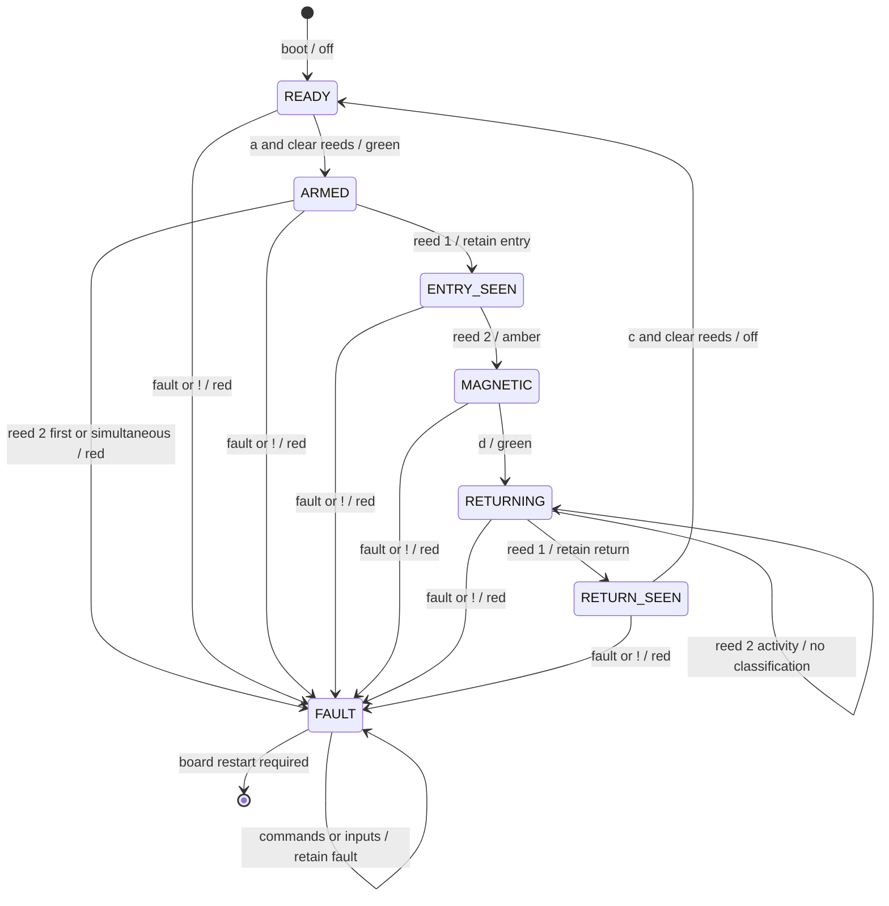

# Sensing Arduino — two reeds and andon

[Shared contract](../CONTRACT.md) · [Build instructions](../README.md#platformio)

Scaffold only. Place reed 1 near the loading/discharge end and reed 2 at the forward magnetic stopping point. Confirm pins, polarity, exposure and debounce on the assembled conveyor.

## Work package and deliverables

Deliver non-blocking sampling/debounce, direction-aware retained events, state-driven LEDs, Wire status and latched faults. Provide reed/LED wiring, resistors, sample interval, measured debounce and placement. Demonstrate reliable detection at the fixed speed. The master checks missing arrival and requests red andon with `!`; this board does not count motor steps.

## States keyed to commands and events

Reed openings do not erase events. Pause does not disarm sensing. No sensor PAUSED state is needed: retain events during deceleration and pauses. Repeated commands must not erase progress. `c` clears a completed healthy discharge, never FAULT. Report live inputs even in READY and FAULT.

Reed 2 may already be active when return mode begins. Its return activity does not create a new detection. Detect a new reed 1 activation as the discharge reference. The master guards return start with reed 1 clear.

## Implementation and verification

Debounce independently of master polling. Retain short valid events and publish one coherent snapshot. Do not use sampling or LED delays in Wire callbacks. LEDs follow sensing state; no independent LED command is needed.

Record tests for short exposure, held/repeated contacts, simultaneous activation, wrong forward order, reverse passage, pause-time events, healthy clear, contact timeout and retained faults. Non-magnetic pucks produce no claimed presence or material result. A disconnected normally-open reed can look inactive. Actual ejection is not independently confirmed.
